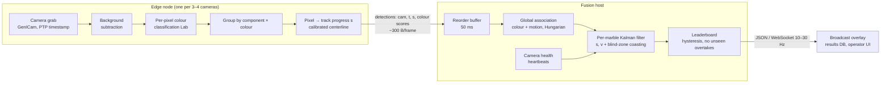

# Marble Race Tracking — System Architecture

Real-time identification, tracking and ranking of colour-coded marbles, from
either **one top-down master camera** or **14 fixed cameras** along the track,
plus an optional high-frame-rate **finish camera**. This document is the
engineering reference; the stakeholder summary with evidence is
[`docs/feasibility-report.html`](feasibility-report.html) and the measured numbers
are in [`results/`](../results).

---

## 1. Requirements

| # | Requirement | Target | How it is verified |
|---|---|---|---|
| R1 | Identify every marble by colour, no ID swaps | 0 identity errors per race | Simulation suite (`id_errors`), on-site annotated races |
| R2 | Live leaderboard correct for all visible marbles | ≥ 99.5 % of published instants | `rank_accuracy` metric |
| R3 | Official finishing order correct | 100 %; physically unresolvable gaps flagged for review, never guessed | `final_order_correct` + `photo_finish` flag |
| R4 | Finish-time accuracy | ≤ 5 ms (30 fps cameras), ≤ 1 ms with finish camera | `finish_err_ms_*` |
| R5 | Latency, capture → published leaderboard | ≤ 150 ms p95 (broadcast overlay) | `scripts/live_demo.py` |
| R6 | Survive occlusion: marble/marble, tunnels/supports, camera gaps | No wrong overtakes while unseen; re-acquire on reappearance | `pack`, `occlusion` scenarios |
| R7 | Survive a camera failure mid-race | Race continues; affected section degrades to "hidden" | `camera_failure` scenario |
| R8 | Survive network loss/jitter and lighting drift | No accuracy loss at 10 % frame loss, 120 ms jitter, −20 % light | `network`, `lighting`, `worst_case` |
| R9 | Same software for 1-camera and 14-camera rigs | One pipeline, configuration only | Both modes run the same code |

## 2. Key design decision: everything happens in *track coordinates*

The track is a 1-D curve. Every marble's state is **progress `s` (metres from the
start gate) and speed `v`**, not an image position. Each camera's calibration
maps image pixels to `s`; after that, nothing downstream knows or cares which
camera, how many cameras, or what perspective produced a measurement.

Consequences:

* **Ranking is a sort on `s`.** No geometry in the leaderboard.
* **Camera hand-off is not a special case.** A marble leaving camera 6 and
  entering camera 7 simply gets its next measurement from camera 7. Overlap zones
  produce two measurements of the same `s`, which the filter fuses.
* **1 camera and 14 cameras are the same system.** The single master camera is a
  rig with one camera covering `s ∈ [0, L]`.
* **Gaps, tunnels and failed cameras are intervals on `s`** ("blind zones"),
  so occlusion reasoning is interval arithmetic.
* **Finish detection is a threshold crossing on `s`**, interpolated between
  frames for sub-frame timing.

## 3. Deployment modes

| | Mode A: master camera | Mode B: 14 segment cameras |
|---|---|---|
| Cameras | 1 × 2.3 MP colour global shutter (e.g. IMX392, ~51 fps) | 14 × 1.6 MP colour global shutter (IMX273, ~75 fps) |
| Ground resolution | ~1.7 mm/px over 3.3 × 2.2 m → 16 mm marble ≈ 9 px, 25 mm ≈ 14 px | ~0.7–1.0 mm/px → 16 mm marble ≈ 16–23 px |
| Best for | Flat tabletop tracks that fit one view, tight budget | Large, multi-level or 3-D tracks; overhangs; broadcast close-ups |
| Weak spots | Resolution limits marble size; anything that overhangs the track hides it; 1 camera = single point of failure | More calibration; 14 × bandwidth; inter-camera consistency |
| Optional | + finish camera (strongly recommended) | + finish camera (strongly recommended) |

**Why not a single 4K camera?** At the ~$500 price point, 12 MP colour sensors
(IMX226-class) are **rolling shutter** and run ~10 fps on GigE / ~31 fps on USB3;
global-shutter 12 MP is ~$3–4k. Rolling-shutter skew distorts fast marbles and
10 fps leaves 30 cm between frames at 3 m/s. A 2.3 MP global-shutter camera at
~50 fps is the better master camera in budget.

**Finish camera.** One extra 1.6 MP camera in ROI mode (a strip around the line)
at ≥ 200 fps turns finish timing from ~±4 ms to ~±0.5 ms and is the single most
cost-effective addition (see §9: in simulation it removed every
"too close to call" result that was caused by frame spacing alone).

## 4. Edge pipeline (per camera)

Implemented in [`marbletrack/detector.py`](../marbletrack/detector.py) and
[`marbletrack/color.py`](../marbletrack/color.py).

1. **Capture.** Fixed exposure (≤ 1 ms to keep motion blur ≤ 3 mm at 3 m/s),
   fixed gain, fixed white balance — auto modes off. Frames carry the camera's
   PTP hardware timestamp.
2. **Foreground.** Per-channel absolute difference to a median background of the
   empty track, thresholded, restricted to the camera's **track mask** (only the
   track surface this camera owns). For sensors > 1.5 MP the mask is computed on
   a half-resolution frame and colours are read at full resolution.
3. **Colour classification.** Each foreground pixel is scored against every
   marble's Gaussian colour model in CIELAB (squared Mahalanobis distance).
   Models are fitted **per camera** during calibration, so each camera's
   white balance, lens vignetting and lighting are absorbed. Pixels matching no
   model (specular highlights, shadows, noise) are discarded.
4. **Grouping.** Pixels are grouped by *(connected component, colour class)*.
   Because each marble's colour is unique, two touching marbles of different
   colours separate without any shape analysis.
5. **Projection to the track.** The group centroid is projected onto the
   camera's calibrated image-space centerline, whose vertices carry the global
   `s` value; this is correct under perspective. Where the track passes near
   itself in the image (spirals, bridges), every nearby pass is returned as a
   candidate and fusion picks the one consistent with the marble's motion.
6. **Uncertainty.** Centroid σ is 1 px, inflated by up to r/2 when the blob is
   smaller than a full marble (partly hidden) — this feeds directly into
   finish-time uncertainty and the photo-finish flag.
7. **Adaptation.** The background is updated slowly from non-marble pixels, and
   each colour model's mean follows unambiguous detections (best match < 9 and
   runner-up > 50), absorbing slow lighting drift without ever pulling a model
   toward a neighbouring colour.

Only detections leave the edge node (camera id, timestamp, `s` candidates,
10 colour scores — a few hundred bytes per frame). **Video never crosses the
network**, which is what makes 14 cameras practical (§7).

## 5. Fusion and tracking (central)

Implemented in [`marbletrack/fusion.py`](../marbletrack/fusion.py).

**Ordering.** A 50 ms reorder buffer releases camera frames in capture-time
order. Anything later than that is still used: the filter compares it with the
state *retrodicted* to its capture time (`s − lag·v`, variance inflated by the
process noise over the lag) instead of treating old data as current.

**State.** Per marble, a constant-velocity Kalman filter on `[s, v]` with white
acceleration noise (σₐ = 4 m/s²). Measurement variance = pixel noise mapped to
metres **plus a 1 cm floor**, which models the ~1 cm by which two overlapping
cameras disagree (calibration, parallax of a marble's centre above the track,
partial occlusion). Without the floor the filter reads that disagreement as
motion and its velocity estimate oscillates — this was found and fixed in
simulation.

**Association.** Each camera frame's detections are matched to marbles with
the Hungarian algorithm on cost = colour distance + normalised motion
innovation, with three gates:
* colour gate (d² ≤ 50),
* **colour ratio test** — a detection may only go to a marble whose colour
  score is within 20 of the detection's best colour score (prevents a hidden
  marble "stealing" a similar-coloured neighbour's detection),
* motion gate (5σ, which widens automatically while a marble is unseen).

Finished marbles keep absorbing their own detections while they roll through
the run-out, then leave association once out of view.

**Occlusion handling**, from short to long:

| Situation | Behaviour |
|---|---|
| Marble partly hidden by another | Colour split keeps both detections; larger σ for the hidden one |
| Marble fully hidden for a moment | Coasts for ≤ 150 ms anywhere on the track |
| Tunnel / support / any permanent occluder | Declared once as a static blind zone; marble may coast to the zone exit, never beyond |
| Gap between camera views | Computed automatically from camera coverage; same as a tunnel |
| Camera stops delivering frames (> 300 ms) | Its section becomes a blind zone; event logged; reverts automatically when frames resume |
| Re-appearance | Re-acquired by colour; motion gate has widened with the covariance |

**Leaderboard.**
* Finished marbles first, by finish time; then by `s`.
* **Hysteresis:** two adjacent marbles swap only when the trailing one leads
  by more than half a marble diameter — no flicker when running side by side.
* **No unseen overtakes:** a marble can only move up while it is actually
  observed. Predictions are not evidence.
* Status per marble: `tracking`, `coasting` (hidden, shown dimmed), `lost`,
  `finished`.

**Finish timing.** Linear interpolation between the two raw observations that
bracket the finish line, with a propagated 1-σ uncertainty. Two finishers are
flagged **photo finish** when their gap is below the system's timing resolution
(2 ms with finish camera, 6 ms without) or below 2σ of their combined
uncertainty. Flagged pairs go to operator review (finish-camera frames) instead
of being decided by the algorithm.

## 6. Calibration (once per installation, ~1–2 h)

1. **Lens/geometry.** Mount, focus and lock each camera. No metric camera
   calibration is needed for ranking: only pixel → `s` matters.
2. **Centerline.** In the calibration tool, click points along the track centre
   in each camera image and give their `s` values (from the track plan, or by
   rolling a reference marble at known spacing). Dense points (every few cm)
   make perspective irrelevant. Mark tunnels/occluders as static blind zones.
3. **Track mask.** Generated from the centerline and track width; touch up by
   painting.
4. **Background.** Capture 2–5 s of empty track per camera (median).
5. **Colour.** Roll each marble through once, alone. The tool collects its
   pixels per camera, fits the colour models, and prints the **palette
   separation matrix** (`palette_separation()`); any pair below 50 must be
   replaced before race day.
6. **Validation run.** One race recorded with frames for review.

## 7. Hardware and network

**Cameras** (research summary; verify current prices before ordering):

| Role | Candidate | Sensor | fps (full) | Interface | Sync | Approx. price |
|---|---|---|---|---|---|---|
| Segment camera (Mode B) | Teledyne FLIR Blackfly S BFS-PGE-16S2C | IMX273 1.6 MP GS | 78 | GigE PoE | PTP, opto trigger | ~$370 |
| Segment camera (Mode B) | LUCID Triton TRI016S-CC | IMX273 1.6 MP GS | ~72 | GigE PoE, IP67 | PTP, action cmds | ~$390 |
| Segment camera (Mode B) | Allied Vision Alvium G1-158c | IMX273 1.6 MP GS | ~74 | GigE PoE | PTP | ~$450–520 |
| Master camera (Mode A) | Basler ace 2 a2A1920-51gcBAS | IMX392 2.3 MP GS | 51 | GigE PoE | PTP (family), opto trigger | ~$380–490 |
| Finish camera | any IMX273 model above in ROI mode, or USB3 Basler a2A1920-160uc | IMX273 / IMX392 | ≥ 200 in ROI | GigE / USB3 | trigger | ~$350–500 |

Lenses: fixed-focal C-mount, ~$130–250 each; ~4–7 mm for the master camera at
2.5–3 m, ~3.5–6.5 mm for segment cameras at ~1 m (wide angle: include
distortion in the centerline calibration — it already is, implicitly, because
the centerline is clicked in the distorted image).

**Bandwidth.** One 1.6 MP Bayer8 camera at 60 fps ≈ 94 MB/s — most of a GigE
link. Therefore each camera gets its own GigE port at the edge node (4-port
PoE NIC), and edge nodes forward **detections only** (~10 kB/s per camera) to
the fusion host. 14 cameras ⇒ 4 edge nodes × 4 ports.

**Time sync.** PTP (IEEE 1588) between cameras and edge nodes (linuxptp),
PTP-capable switch. The fusion filter is continuous-time, so cameras do **not**
need to expose simultaneously (the simulation uses free-running cameras with
random phase); they need **accurate timestamps**. Error budget: 1 ms timestamp
error = 3 mm at 3 m/s, so millisecond-level sync is ample and PTP gives
microseconds.

**Lighting.** Flicker-free DC LED panels, diffuse, fixed. This is the single
most important environmental control: exposure ≤ 1 ms needs plenty of light,
and stable light keeps the colour models valid (adaptation handles slow drift,
not flicker).

**Compute.** See §9 for measured per-frame costs. Reference sizing: an 8-core
x86 mini-PC per 4 cameras at 60 fps with the C++/OpenCV port, or the present
Python implementation at 30 fps. Fusion is < 0.3 ms per frame batch — one
core of any machine.

**Bill of materials (Mode B, indicative):** 15 cameras (14 + finish) ≈ $6–7.5k;
15 lenses ≈ $2–3.5k; 4 edge mini-PCs + PoE NICs ≈ $4–5k; PTP switch,
cabling, mounts ≈ $1.5–2.5k; LED lighting ≈ $1–2k. **≈ $15–20k.**
Mode A (master + finish camera) ≈ $3–5k including compute and lighting.

## 8. Software components and interfaces

| Component | Module | Notes |
|---|---|---|
| Track geometry | `marbletrack/track.py` | Polyline with per-vertex `s`; multi-candidate projection |
| Colour models | `marbletrack/color.py` | Lab Gaussian per marble per camera; robust fit; separation check |
| Edge detector | `marbletrack/detector.py` | Background, classification, grouping, projection, adaptation |
| Fusion + leaderboard | `marbletrack/fusion.py` | Association, KF, blind zones, camera health, photo finish, events |
| Runtime | `marbletrack/runtime.py` | Edge processes, reorder buffer, HTTP/JSON leaderboard publisher |
| Simulator | `marbletrack/sim.py` | Track, physics-free race, camera rigs, rendering, calibration |
| Evaluation | `marbletrack/race.py`, `scripts/monte_carlo.py` | Scenarios, ground-truth scoring |

**Detection message** (edge → fusion): `cam_id, t_capture, [ {xy, area,
color_d2[K], candidates:[{s, dist, s_per_unit}], sigma_px} ]`. Heartbeat =
any frame message, including empty ones.

**Leaderboard message** (fusion → consumers, 10–30 Hz): `t, board:[{rank,
marble_id, progress_m, speed_mps, status, finish_time, gap_m, photo_finish}],
cameras:{id: online}` plus an event stream (`finish`, `camera_offline`,
`camera_online`).

**Production hardening still to do** (planned in §10): camera SDK adapter
(GenICam via the vendor SDK or Harvester), ZeroMQ/NATS transport between hosts
(the in-process queue is the same message contract), C++ port of the edge
detector hot loop, calibration GUI, operator review UI for photo finishes,
recording of raw frames around the finish for audit, metrics/alerting.

## 9. Evidence summary

All numbers are produced by the code in this repository; re-run with the
commands in the README. The full stakeholder report with charts is
[`docs/feasibility-report.html`](feasibility-report.html).

<!-- RESULTS:START -->
_Filled in from `results/monte_carlo.json` and `results/benchmark.json`._
<!-- RESULTS:END -->

**What simulation proves, and what it does not.** The simulator validates the
algorithms (identity, association, fusion, occlusion logic, ranking, timing)
end to end against exact ground truth, under deliberately harsher-than-real
conditions (marbles pass *through* each other, so a marble can be hidden by
another for long stretches — physically impossible from a top-down view). It
does not validate real optics, real colour behaviour of glass marbles
(swirls, transparency, reflections of neighbours) or real lighting. Those are
the purpose of the on-site acceptance phase (§10, phase 2), which uses the same
metrics against manually annotated video.

## 10. Implementation plan

| Phase | Duration | Deliverables | Exit criteria |
|---|---|---|---|
| 0. Algorithm proof (done) | — | This repository: pipeline, simulator, stress suite, live demo | All scenarios pass in simulation |
| 1. Hardware bring-up | 2 weeks | Buy 2 segment cameras + finish camera + lighting; camera SDK adapter; PTP; record test footage | Frames with PTP timestamps flowing into the edge detector |
| 2. Single-segment field trial | 2 weeks | Calibration tool v1; real marbles on a real track section; colour separation report for the actual marble set | ≥ 99.5 % correct identity on 20 annotated runs; palette all-pairs ≥ 50 |
| 3. Full rig (Mode A or B) | 3 weeks | All cameras installed and calibrated; edge nodes; transport; leaderboard feed into overlay | Live end-to-end latency p95 ≤ 150 ms; camera-failure drill passed |
| 4. Acceptance | 2 weeks | 50 recorded races, manually annotated ground truth; operator photo-finish review UI | R1–R8 met on real races; zero unflagged finish-order errors |
| 5. Production hardening | 2–3 weeks | C++ hot loop, monitoring, auto-restart, frame archive, runbook | 4-hour soak test without intervention |

Team: 1 computer-vision engineer (lead), 1 software engineer (runtime,
overlay, tooling), part-time technician for rig/lighting. **~11–12 weeks to
production.**

## 11. Risks and mitigations

| Risk | Likelihood | Impact | Mitigation |
|---|---|---|---|
| Two marbles too similar in colour under the rig lighting | Medium | ID swaps | Palette separation check at calibration; choose marble set by measurement, not by eye; ratio test in association |
| Swirled / transparent / glitter marbles | Medium | Colour models broad | Models are fitted on the marble's own pixel distribution (multi-modal colour is absorbed by the covariance); if needed swap to a per-marble histogram/GMM model — same interface |
| Lighting flicker or daylight | Medium | False foreground, colour shift | DC LED lighting, blackout; background/colour adaptation handles slow drift |
| Marble leaves the track / jumps | Low | Lost marble | Status `lost`; re-acquired by colour anywhere on the track (motion gate widens) |
| Overhanging track pieces in Mode A | Track dependent | Long blind zones | Declare blind zones; add a segment camera there (modes can be mixed) |
| Camera failure during race | Low | Section blind | Automatic blind zone; race continues; alert operator |
| Photo finish below timing resolution | Certain, occasionally | Ambiguous result | Finish camera; automatic photo-finish flag + frame review |
| Compute falls behind | Low | Dropped frames | Edge drops frames rather than queueing (bounded latency); sizing margin ≥ 2× |
